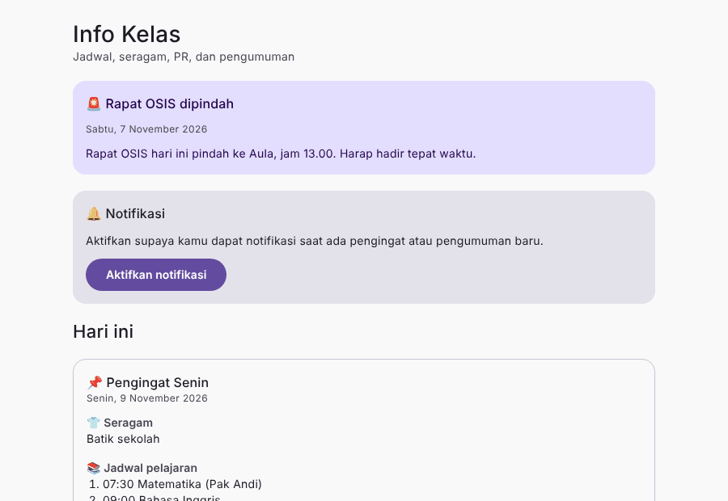
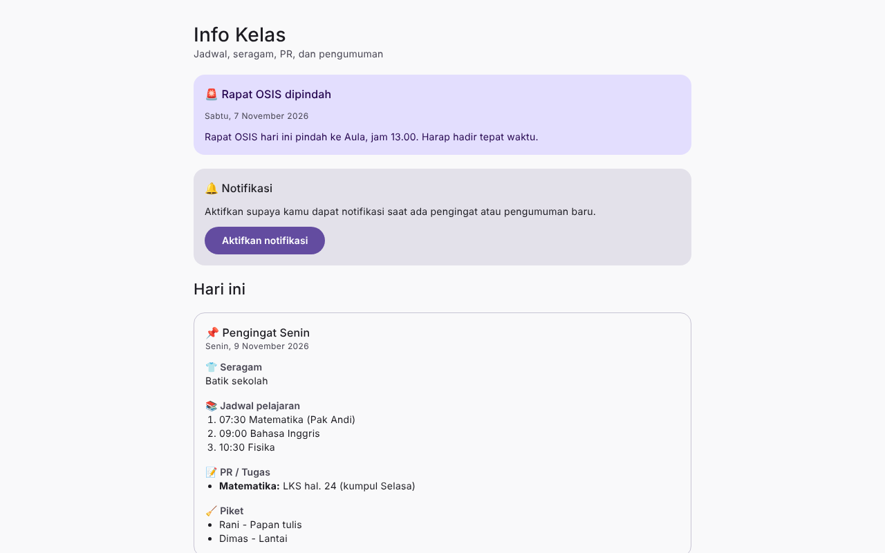
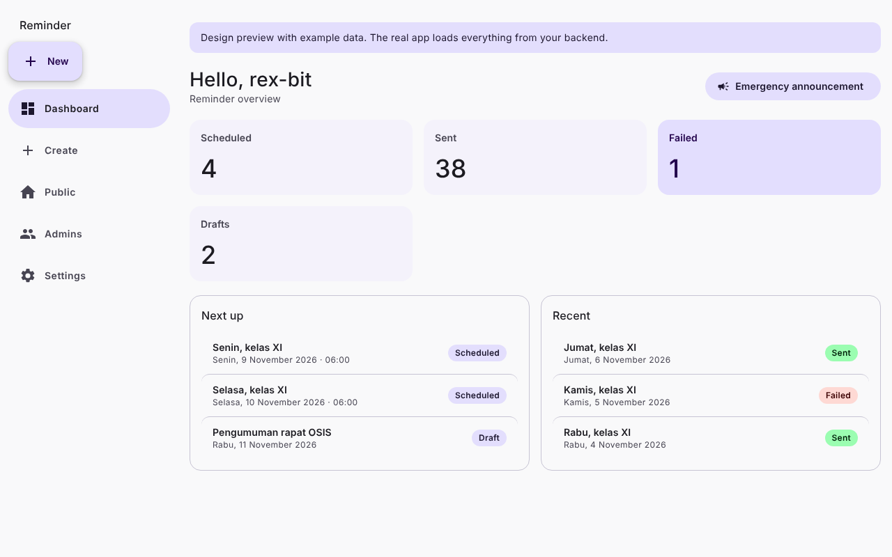
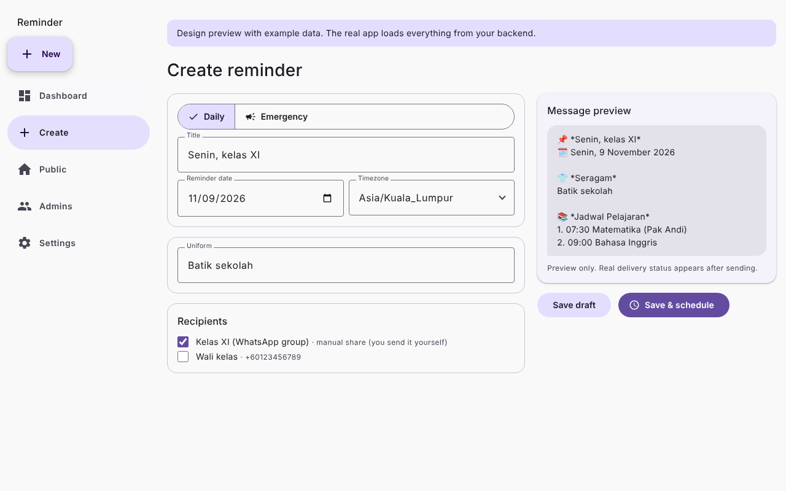
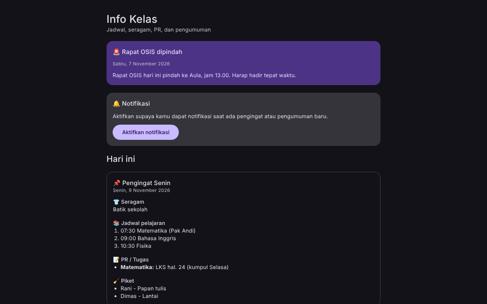
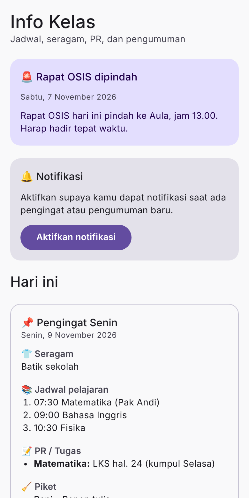
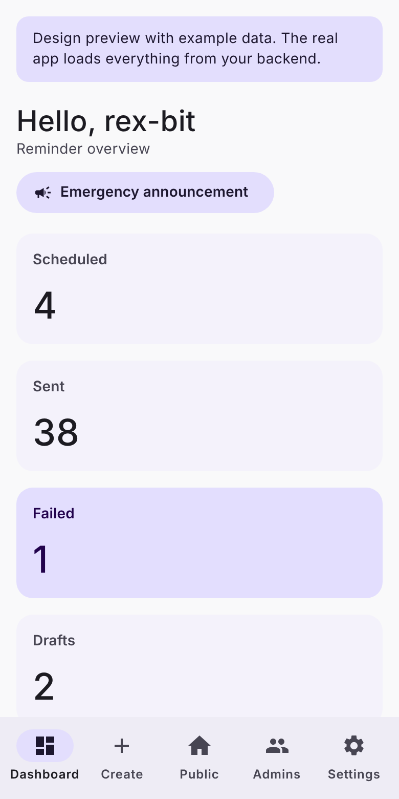

<p align="center"></p>

# Reminder System + WhatsApp Bot

Personal project: reminder management for admins, with scheduled delivery through the official WhatsApp Business Platform (Cloud API).


## Preview

> Design mockups with example data (the layout and colors are the real ones; the app itself needs the backend to run).



| Public class page (no login) | Admin dashboard | Create reminder |
|---|---|---|
|  |  |  |

| Dark theme | Phone (public) | Phone (admin) |
|---|---|---|
|  |  |  |

## Layout

| Dir | Purpose | Status |
|---|---|---|
| `backend/` | Express + PostgreSQL REST API (auth, RBAC, reminders, scheduler) | Phase 1 + 3 written (Phase 3 not yet run end-to-end) |
| `bot/` | Separate WhatsApp Cloud API service | Phase 4 written (see `docs/WHATSAPP.md`) |
| `frontend/` | React + TS, Material 3 (deployable to GitHub Pages) | Phase 2 written, not yet built/run (see below) |
| `docs/` | Architecture, API, deployment | ongoing |

Frontend, backend and bot are independent packages (no root workspace) so each can be deployed on its own.

## Phase 1 quick start (backend)

```bash
docker compose up -d            # local Postgres + Redis
cd backend
cp .env.example .env            # fill in secrets (see comments inside)
npm install
npm run migrate                 # apply SQL migrations
npm run seed                    # roles, permissions, first Owner account
npm run dev                     # http://localhost:4000/healthz (API + delivery worker; needs Redis)
```

Generate secrets with `openssl rand -base64 48`.

See [`docs/ARCHITECTURE.md`](docs/ARCHITECTURE.md), [`docs/API.md`](docs/API.md), [`docs/DEPLOYMENT.md`](docs/DEPLOYMENT.md) (Vercel + Pterodactyl + Nginx) and [`docs/TESTING.md`](docs/TESTING.md).

**Phase 4 status:** the webhook signature check, status parsing and the SQL that applies statuses (ordering, duplicates) were executed and pass. Nothing has been sent through the real Meta API: that needs your Meta app, token and an approved number or template.

**Phase 3 status:** the SQL used by the scheduler and APIs was run against a real PostgreSQL 16 (dedupe of jobs and deliveries, retries, recurrence insert). The Node code has only been syntax-checked and its time/message helpers executed; `npm install` was not possible, so `tsc`, `vitest` and a live server + Redis run are still to do.

## Phase 2 quick start (frontend)

```bash
cd frontend
cp .env.example .env     # VITE_API_URL=https://api.example.com/api/v1
npm install
npm run dev              # http://localhost:5173
npm run build            # static files in dist/ (Vercel: root dir `frontend`; GitHub Pages: set VITE_BASE=/<repo>/)
npm run typecheck        # not part of build; run it to catch type errors
```

- Material 3 theme with dynamic color from a seed color (OKLCH-based approximation of M3 tonal palettes), light/dark/system, saved in `localStorage`.
- Adaptive navigation: bottom bar (<600px), rail (600-1199px), expanded rail (>=1200px).
- Uses a hash router so GitHub Pages needs no rewrite rules. Only the public API URL is in the build; no secrets.
- Date/time inputs use the browser's native pickers inside M3 text fields.
- **Status:** the code has been syntax-checked and the palette/date helpers run, but `npm install`, `tsc` and `vite build` have not been run yet. Pages call the endpoints in [`docs/API.md`](docs/API.md); only `/auth/*` and `/activity` exist in the backend today, the rest arrive in Phase 3, so those pages show an error state until then.

## Public class page
Students open the site without logging in (`/#/`) to see today's schedule, uniform, homework, piket and announcements, and can turn on notifications. The Owner enables it in Settings (off by default). Admin login is only at `/#/login`; any other panel URL shows "no access" to visitors.

## Notifications instead of auto-posting (class groups)
Because the official API cannot post into an existing group, the recommended setup is **Manual share + notifications**: at the scheduled time you get a push notification, tap it, and share the prefilled message to your group yourself. Setup: `npx web-push generate-vapid-keys`, put the keys in `backend/.env`, deploy the frontend over HTTPS, then Settings > Notifications > Enable. See `docs/WHATSAPP.md`.

## WhatsApp limitations (details in [`docs/WHATSAPP.md`](docs/WHATSAPP.md))

- Only the official Cloud API is used. No WhatsApp Web automation or QR login.
- Sending to arbitrary existing groups is **not assumed** to be possible. Group eligibility will be verified against current Meta docs in Phase 4; until then group recipients use the manual-share fallback (admin action required).
- Business-initiated messages outside the 24h window need approved templates.
